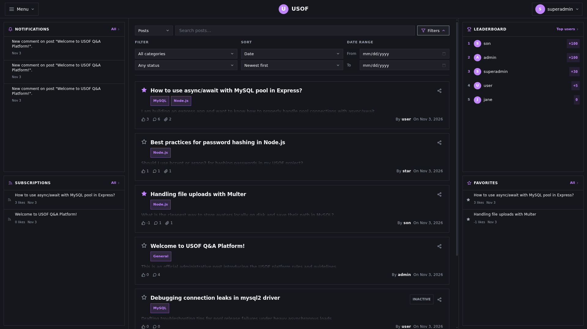
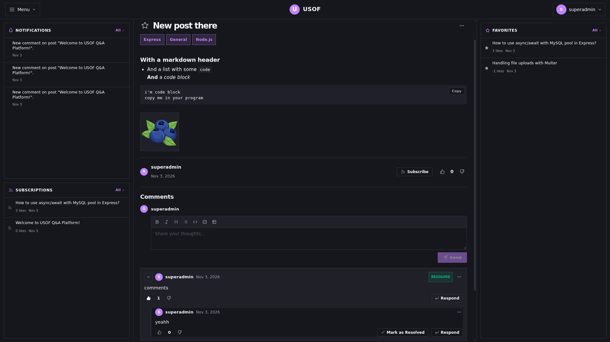
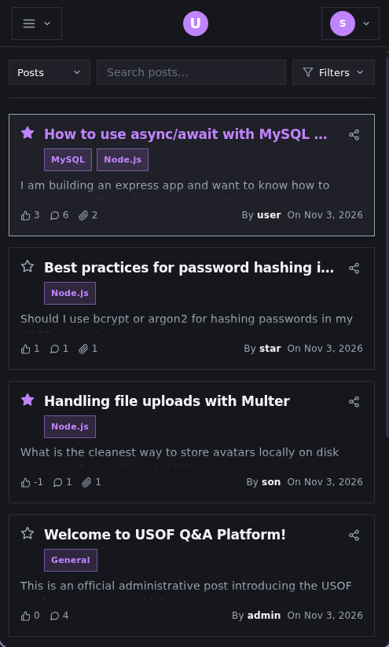
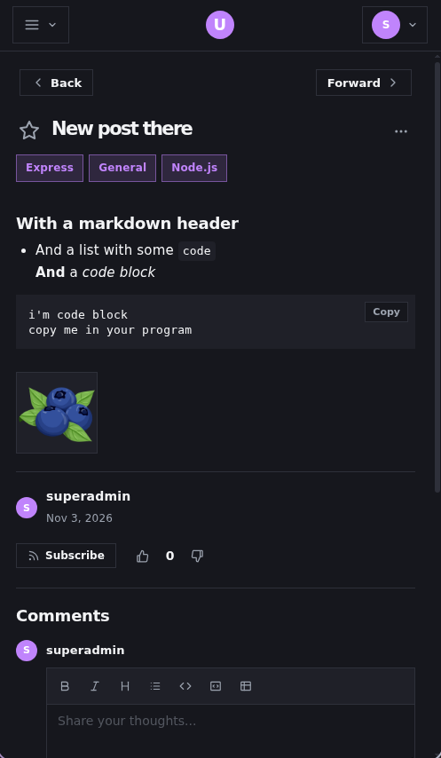
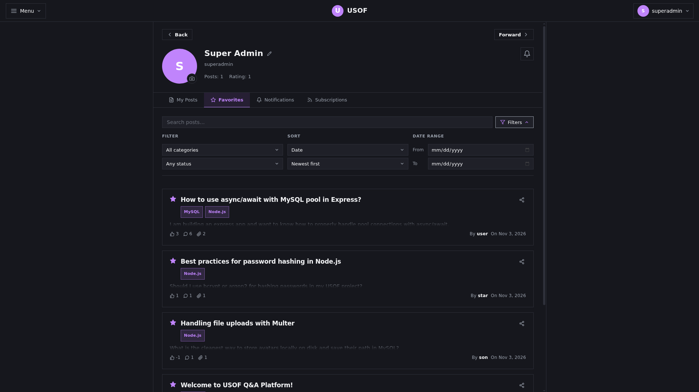
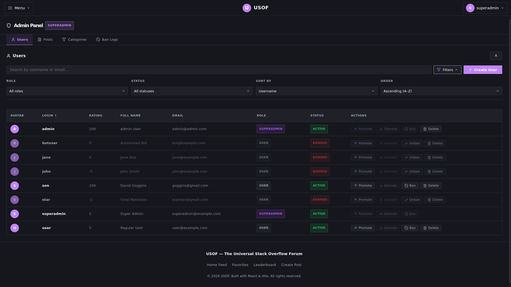
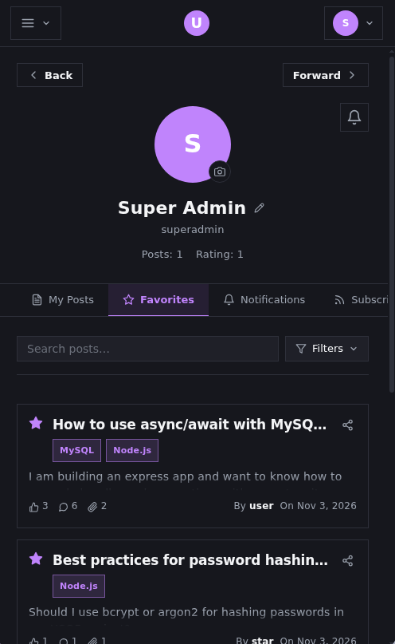
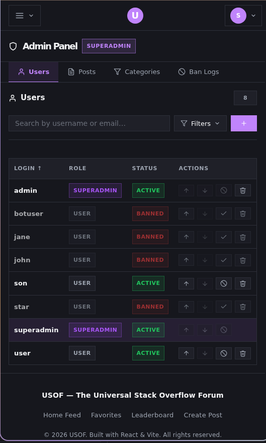

# USOF — Frontend

A Q&A forum similar to Stack Overflow: users post questions, categorize and search them, comment, react with likes/dislikes, favorite and subscribe to posts, and get rated by others on overall/weekly leaderboard. This repository holds the **React + Redux frontend**; it consumes the Express/MySQL REST API in [`API/`](./API).

For the full Challenge-Based-Learning documentation (Engage/Investigate/Act reflections + program architecture), see [`docs/CBL.md`](./docs/CBL.md). For backend-specific setup, request flow, and database schema docs, see [`API/README.md`](./API/README.md).

## Screenshots

| | |
|---|---|
|  |  |
| Home feed — sorting, filtering, and post previews | Post detail — markdown content, reactions, nested comments |
|  |  |
| Mobile Home feed | Mobile Post detail |
|  |  |
| User profile — posts, favorites, notifications tabs | Admin panel — user/post moderation, category management |
|  |  |
| Mobile User profile | Admin panel |

## Requirements & Dependencies

### System requirements

- [Node.js](https://nodejs.org/) v22+
- npm (comes with Node.js)
- The backend also requires [MySQL](https://www.mysql.com/) v8+ — see [`API/README.md`](./API/README.md) for its full setup.

### Key packages (installed via `npm install`)

| Package | Purpose |
|---|---|
| [react](https://www.npmjs.com/package/react) / [react-dom](https://www.npmjs.com/package/react-dom) | UI library |
| [vite](https://www.npmjs.com/package/vite) | Dev server & build tool |
| [react-router-dom](https://www.npmjs.com/package/react-router-dom) | SPA routing, lazy-loaded routes |
| [@reduxjs/toolkit](https://www.npmjs.com/package/@reduxjs/toolkit) / [react-redux](https://www.npmjs.com/package/react-redux) | State management (required by the assignment) |
| [axios](https://www.npmjs.com/package/axios) | HTTP client, auth-header injection, error normalization |
| [react-markdown](https://www.npmjs.com/package/react-markdown) | Markdown rendering for post/comment content |
| [remark-gfm](https://www.npmjs.com/package/remark-gfm) / [remark-breaks](https://www.npmjs.com/package/remark-breaks) | GitHub-flavored Markdown + soft line breaks |

## How to run

### 1. Start the backend first

```bash
cd API
cp .env.example .env   # fill in real values — see API/README.md for details
npm install
npm run db:recreate    # creates + seeds the database (may need sudo on Linux)
npm start               # starts at http://localhost:3000
```

Full backend setup, `.env` variable meanings, and test account credentials are documented in [`API/README.md`](./API/README.md).

### 2. Start the frontend

From the repository root:

```bash
cp .env.example .env   # VITE_API_URL=http://localhost:3000/api by default
npm install
npm run dev
```

Visit [http://localhost:5173](http://localhost:5173).

## Tech stack & reasoning

- **React + Vite** — required framework for the assignment; Vite was chosen over CRA because CRA is depricated and React wiki even makes an accent on supperiority of Vite over the CRA. (but turns out i was actually supposed to use CRA, but _"oh well"_).
- **Redux Toolkit** — the assignment mandates Redux for state management. Toolkit was used over plain Redux for `createSlice`'s Immer-based reducers and `createAsyncThunk`'s built-in pending/fulfilled/rejected lifecycle, cutting out most of classic Redux's boilerplate (action-type constants, manual immutable updates, hand-written thunks).
- **React Router** — client-side routing with per-route code-splitting (`React.lazy`), so the initial bundle stays small.
- **Axios** — a single configured instance (`src/utils/api.js`) centralizes JWT attachment (request interceptor) and error-shape normalization (response interceptor), so every service call and component gets a consistent `{ status, message, errors }` on failure instead of handling raw axios errors ad hoc.
- **react-markdown** — chosen over `marked` + `dangerouslySetInnerHTML` specifically for its built-in XSS safety: post/comment content comes from other users, so it's rendered through a safe AST-based renderer rather than injected as raw HTML.

## Folder structure overview

```
src/
├── components/   # Reusable UI, grouped by feature (posts/, post-detail/, profile/, widgets/, ui/, layouts/)
├── pages/        # Route-level components (one per page, lazy-loaded via lazyPages.js)
├── redux/
│   └── slices/   # One Redux Toolkit slice per state domain (auth, theme, flash, notifications,
│                 # postsFeed, postDetail, comments, leaderboard)
├── services/     # Thin axios wrappers, one file per backend resource (posts, users, comments, ...)
├── hooks/        # Shared custom hooks (polling, debouncing, async data, SSE post events, ...)
├── constants/    # Route paths, API endpoint paths, polling intervals
├── utils/        # Formatting, validation, markdown config, attachment helpers
├── router.jsx    # Route tree definition
└── lazyPages.js  # Lazy-loaded page imports
```
